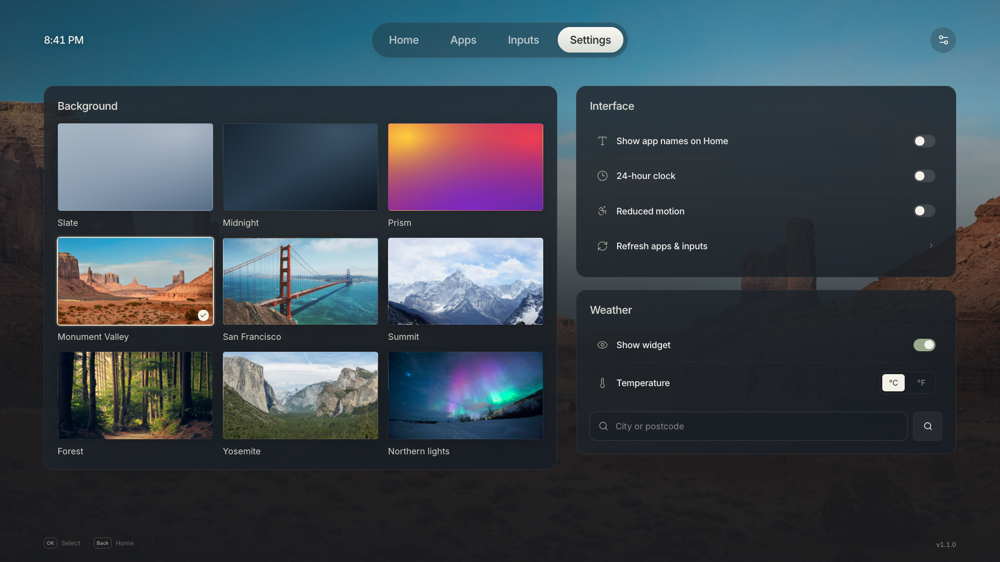
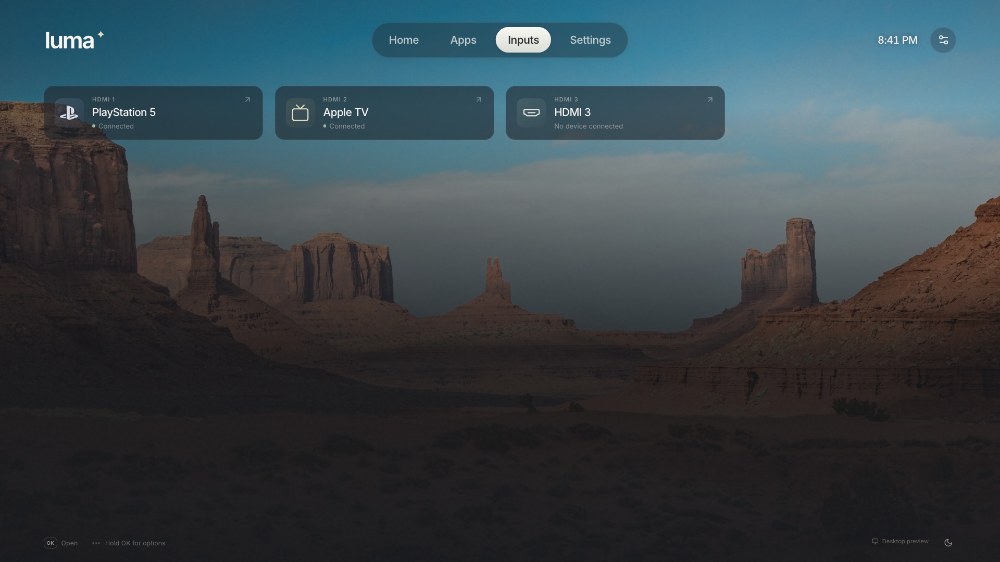

# Luma

A native launcher for rooted LG webOS TVs, inspired by Apple TV.

> [!NOTE]
> Tested on **LG OLED55C57** running **webOS 26**.\
> External testing confirms compatibility with **webOS 6 and newer**.

<table>
  <tr>
    <td width="50%" align="center">
      
    </td>
    <td width="50%" align="center">
      
    </td>
  </tr>
  <tr>
    <td width="50%" align="center">
      
    </td>
    <td width="50%" align="center">
      
    </td>
  </tr>
</table>

## Installation

### Homebrew Channel

```text
https://github.com/ecklf/lg-luma/releases/latest/download/repo.json
```

### SSH

On your computer, replace `TV_IP`:

```sh
scp -O dist/com.ecklf.luma_2.0.2_arm.ipk root@TV_IP:/tmp/luma.ipk
ssh root@TV_IP
```

In the TV's root shell:

```sh
luna-send -i luna://com.webos.appInstallService/dev/install \
  '{"id":"com.ecklf.luma","ipkUrl":"/tmp/luma.ipk","subscribe":true}'
```

## Optional: boot and Home-button routing

After verifying Luma, enable the bundled cold-boot hook in the TV's root shell:

```sh
sh /media/developer/apps/usr/palm/applications/com.ecklf.luma/autostart.sh enable
```

It launches after a full boot with a 25-second delay. Disable before uninstalling:

```sh
sh /media/developer/apps/usr/palm/applications/com.ecklf.luma/autostart.sh disable
```

Use [LG Input Hook](https://repo.webosbrew.org/apps/org.webosbrew.inputhook/) for optional Home-key
routing. Configure its Execute action with this one-line command:

```sh
/usr/bin/luna-send -t 1 -w 5000 luna://com.webos.service.applicationmanager/launch '{"id":"com.ecklf.luma"}'
```

Test on a spare button first. Disable the mapping in Input Hook to restore normal Home behavior.
Installing Luma does not enable either optional routing integration.

### Native Home replacement (webOS 25/26)

The optional Home integration uses the same bind-mount approach as
[Glasshouse Home](https://github.com/rorygallagher2024/glasshouse/blob/main/server/lib/home-takeover.js),
with Luma's native renderer. Install a package built with this integration first, then run as root:

```sh
APP=/media/developer/apps/usr/palm/applications/com.ecklf.luma
sh "$APP/autostart.sh" disable
sh "$APP/home.sh" enable
```

`enable` outlines the changes and asks `Apply these changes? [y/n]:`. Enter `y` to proceed.
Entering `n` or ending input cancels before the command makes changes.

Disable any Home mapping in LG Input Hook and any other Home replacement first. This mounts a
native Luma manifest over `com.webos.app.home`, so normal Home actions open Luma. The integration
reapplies the mount at cold boot and follows the TV's existing Home Auto Launch and Quick Start+
settings. It is intended to cover standby wake onto Home as well. **Home replacement is experimental
and needs manual verification on the TV**, independently of Luma's normal app compatibility.

Status and restoring LG Home, including from an SSH session after a failed launch:

```sh
sh /var/lib/luma-home/home.sh status
sh /var/lib/luma-home/home.sh disable
```

Disable this integration before uninstalling Luma. The restore command remains available outside
the installed package, and `restore` is an alias for `disable`. Boot diagnostics are written to
`/var/lib/luma-home/boot.log`.

## Development

### Setup & Building

From the repository root, with Nix flakes enabled:

```sh
nix develop
pnpm install --frozen-lockfile
pnpm sdk
export WEBOS_NDK="$PWD/.build/toolchain/arm-webos-linux-gnueabi_sdk-buildroot"
pnpm run package
```

The first native runtime preparation also downloads a
checksum-pinned SDL-webOS library; both downloads are cached under `.build/`.

Output:

```text
dist/com.ecklf.luma_2.0.2_arm.ipk
dist/sha256sums
dist/repo.json
dist/app-icon-large.png
```

Open [webOS Dev Manager](https://github.com/webosbrew/dev-manager-desktop), connect to the TV's
IP on port **22** as **root**, and install the IPK. Open **Luma** from the TV menu. Homebrew
Channel must be elevated; on webOS 26 use **0.8.0-rc1 or newer** for its `lunabus.query` mapping.

The native package uses **`com.ecklf.luma`** and installs separately from the old
`com.luma.launcher` web app and the former `com.luma.launcher.native` / `com.luma.native` prototypes. Native preferences
are local JSON files and are separate for each installation; browser preferences are not migrated.
Homebrew Channel treats this ID as a separate app rather than an update to the old launcher.

Wait for installation success; Ctrl+C closes an ongoing subscription. Fully close and reopen
Luma after updating. The [development guide](development.md#tv-startup-diagnostics) has a jailed
launch command that exposes errors hidden by the normal menu launch.

## Preview

```sh
nix develop
pnpm install --frozen-lockfile
pnpm assets
pnpm dev
```

The desktop preview uses sample inventory and never calls TV services. To manually exercise a
longer app grid:

```sh
pnpm dev --test-extra-apps 120
```

Preview preferences are separate from normal preferences. See [development.md](development.md)
for controls, vector rendering, diagnostics, tests and the source layout.

## Privacy and scope

App/input discovery uses fixed inventory commands through Homebrew Channel's elevated service.
App launches use the native Luna bus with declared permissions. There is no demo inventory
fallback on the TV. Native caller permissions and lifecycle behavior can differ by firmware.

Favorites, hidden apps, settings, weather location and cached readings stay in local JSON files
in an app-owned persistent directory outside the installed payload.
Weather search/forecast requests go to Open-Meteo, with embedded TLS roots and bounded responses.
There is no browser geolocation, IP-based location lookup, telemetry or runtime font download.

Luma is licensed under MIT.
Luma is not affiliated with LG, Apple, Plex or any app brands shown in its UI.
