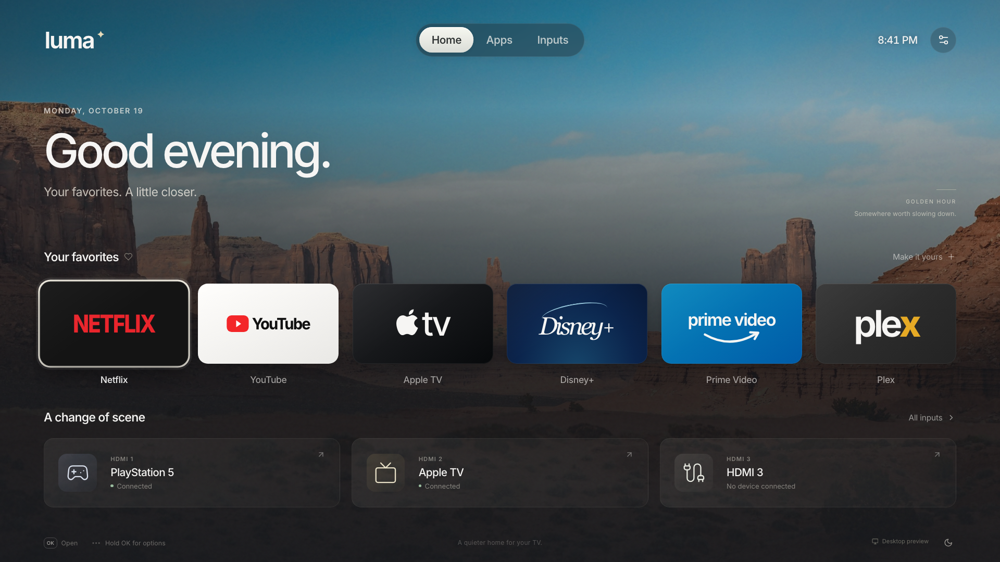

# Luma

**A quieter home for your TV.** A modern, remote-first launcher for rooted LG webOS TVs, inspired by the clarity and feel of Apple TV.

Luma brings your installed apps and HDMI inputs into a locally rendered home screen: cinematic backdrops, large app tiles, spring-based focus, editable favorites, and a full app library. No accounts, recommendations, tracking, weather services, or runtime internet requests.



## Run on your Mac

Node.js 22+:

```sh
npm ci
npm run dev
```

Open **http://127.0.0.1:5173**. Desktop preview shows clearly identified sample apps and inputs; app launches display a preview message. On a TV, only its actual inventory is shown.

## Build an installable package

```sh
npm run package
```

Output: `dist/com.luma.launcher_0.1.0_all.ipk`, plus `dist/sha256sums`. The standalone app is also in `dist/app/`, and works directly from `index.html` without a server.

Photographs and fonts are checked in locally. `npm run assets` prepares them again if you deliberately remove them; it downloads from Unsplash, jsDelivr and the Inter repository at build time. Normal builds and TV use require no asset downloads.

## Install on your rooted TV

1. Open Homebrew Channel on your TV; check **Settings → Root status: ok**.
2. Open [webOS Dev Manager](https://github.com/webosbrew/dev-manager-desktop) on your Mac.
3. Connect to `10.120.1.99`, port `22`, user `root`, using your existing SSH password or key.
4. Install `dist/com.luma.launcher_0.1.0_all.ipk` and launch **Luma**.

Or register your root SSH connection with the locally installed CLI:

```sh
npx ares-setup-device
# Add profile "tv": host 10.120.1.99, port 22, user root; choose your SSH authentication.
npm run deploy -- --device tv
```

The package has its own ID and installs alongside LG Home and LG-XMB.

## Remote and pointer controls

| Input                  | Action                                                   |
| ---------------------- | -------------------------------------------------------- |
| Arrow keys             | Spatial navigation between tiles and controls            |
| OK / Enter             | Open the focused app, input, or control                  |
| Hold OK                | App options: favorite, hide, or reorder                  |
| Menu / right-click / M | Options for the focused app                              |
| Back / Escape          | Close the current panel; return from Apps/Inputs to Home |
| Back on Home           | webOS's normal platform Back behavior                    |
| Magic Remote pointer   | Point, click, or hold a tile for options                 |

Apps → select an app → hold OK to edit favorites. Move pinned apps left or right from the same panel. Hidden apps remain installed and can be restored with **Apps → Hidden apps**. Settings includes three bundled backdrops, 12/24-hour time, reduced motion, refresh, TV settings, and a quiet ambient clock.

## Optional: open at boot

After testing the installed app, run this inside the TV's root SSH shell:

```sh
sh /media/developer/apps/usr/palm/applications/com.luma.launcher/autostart.sh enable
```

This adds an app-owned hook at `/var/lib/webosbrew/init.d/65-luma`. It launches after a full boot with a 25-second delay. It does not run on every standby wake. Disable it before uninstalling:

```sh
sh /media/developer/apps/usr/palm/applications/com.luma.launcher/autostart.sh disable
```

## Optional: remote Home button

Use [LG Input Hook](https://repo.webosbrew.org/apps/org.webosbrew.inputhook/) to map your remote's Home key to this command (one line):

```sh
/usr/bin/luna-send -t 1 -w 5000 luna://com.webos.service.applicationmanager/launch '{"id":"com.luma.launcher"}'
```

The `-t` launch route is based on LG-XMB's webOS 10+ root-shell behavior. Test the mapping on a spare button first. In LG-XMB, select **Settings → Remote → Home button → LG Home** before switching to another input hook. A Home event may otherwise be handled by two launchers. Disable the Luma mapping in Input Hook to restore the normal button.

Luma does not inject code into LG services, replace the stock launcher, bind-mount system directories, or copy LG-XMB's native hooks. Root-only Home routing is separate from the app itself.

## Compatibility and privacy

- Targets webOS 24–26 / Chromium 108+. Graphics are packaged at 1920 × 1080 and scale for desktop preview.
- App/input discovery uses Homebrew Channel's elevated `exec` service, following the integration approach documented by the working LG-XMB project. Fixed inventory commands read only app and physical-input lists.
- App launches use the public application manager API with the `application.launcher` and `application.query` ACGs. No service permissions are rewritten.
- Service bridges are retained until completion, bounded by timeouts, and cancelled afterward. Partial refresh failures preserve the last valid inventory.
- All app names and IDs come from inventory on the TV. A failure never substitutes desktop sample apps.
- Preferences and recent launches stay in this app's local storage. No telemetry or remote requests. The packaged Content Security Policy disables web network connections.
- Homebrew Channel permissions and native service behavior need verification on the physical TV, particularly webOS 26. Browser tests cannot establish hardware compatibility.

## Checks

```sh
npm run check
npm test
npx playwright install chromium
npm run test:browser
```

Browser checks cover packaged `file://` loading, remote navigation, hold-OK options, favorites, settings, search, persistence, focus restoration and TV-service failure behavior with a mock bridge. They do not connect to a TV.

## Structure

`src/` contains React/TypeScript UI, spatial navigation, local preferences and the webOS bridge. `public/` contains locally bundled assets. `tools/` builds a classic-script app and IPK. `tv/autostart.sh` is the optional boot hook.

Project filenames use lowercase kebab-case, including React components (for example, `app-tile.tsx`).

MIT for Luma's source. See [assets.md](assets.md) for artwork, font, icon, and integration references.
